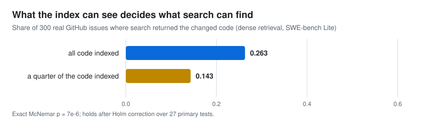
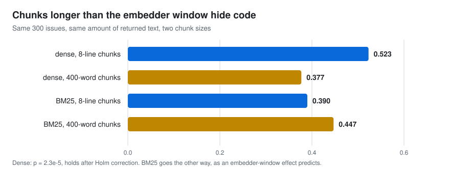

# Purnima Pathak

Measurement-first ML / NLP researcher: data-centric interpretability, model reliability, and on-device efficiency. I study how the data and interventions applied to a model change its behavior (memorization, factuality), and I hold my own results to a hard standard: I report nulls and correct my own false positives.

[Website](https://pupa3066.github.io) · [LinkedIn](https://www.linkedin.com/in/purnima-pathak-86597b296) · [ORCID 0009-0000-6441-7962](https://orcid.org/0009-0000-6441-7962) · [Kaggle](https://www.kaggle.com/purnimapathak15)

## Selected work

- [gemma4-agent-track-blind-spots](https://github.com/pupa3066/gemma4-agent-track-blind-spots): code and data for the Gemma 4 Developer Agent Paper Track writeup *What a Code Search Index Cannot See: Coverage, Chunk Length, Missing Async Code*. Coverage and chunk length both replicated on 300 real GitHub issues (SWE-bench Lite, 12 repositories), registered before the data.
- [quant-memorization-study](https://github.com/pupa3066/quant-memorization-study): does quantization change what a model memorizes and how reliably it recalls facts? Extends black-box memorization probing (Ravichander et al., 2025, arXiv:2503.12072). INT4 leaves factual accuracy unchanged (a replicated null); memorization follows model scale, not precision. Released as a Figshare preprint, DOI: [10.6084/m9.figshare.33858859](https://doi.org/10.6084/m9.figshare.33858859). Cross-hardware replication (NVIDIA CUDA) by Akshay Upadhyay.
- [context-configuration-builder](https://github.com/pupa3066/context-configuration-builder): a pre-registered controlled study of repository context for coding agents, building on a published negative result (ETH, arXiv:2602.11988): does access-pattern-tiered context recover task success at lower cost? Real SWE-bench test grading and from-scratch statistics (McNemar, bootstrap CIs, non-inferiority). BSL 1.1.
- [gemma4-agent-selftest-scorable-tasks-and-traces](https://www.kaggle.com/datasets/purnimapathak15/gemma4-agent-selftest-scorable-tasks-and-traces): Kaggle dataset; which of the competition's 129 published tasks can be scored locally (72), with every per-task result and trace.

  <picture>
    <source media="(prefers-color-scheme: dark)" srcset="assets/coverage-dark.svg">
    
  </picture>

<samp>fig. 1</samp>: coverage, not the retrieval method, sets the ceiling; from gemma4-agent-track-blind-spots

  <picture>
    <source media="(prefers-color-scheme: dark)" srcset="assets/chunk-length-dark.svg">
    
  </picture>

<samp>fig. 2</samp>: the same code, cut longer than the embedder reads, stops being found; from gemma4-agent-track-blind-spots

## Approach

Pre-register hypotheses. Use only measured facts; label everything unverified. Build the instrument correctly (I document the bugs). Prefer an honest null or a characterized tradeoff over an inflated number.

## Background

M.S. Telecommunications, University of Colorado Boulder (2019). A decade in software and systems engineering since 2013: Cisco (VPN dataplane PKI/AAA, TLS/DTLS traffic analysis), plus systems and migration engineering at Unisys and TATA Power. Now independent research in hardware-efficient ML and NLP interpretability.
